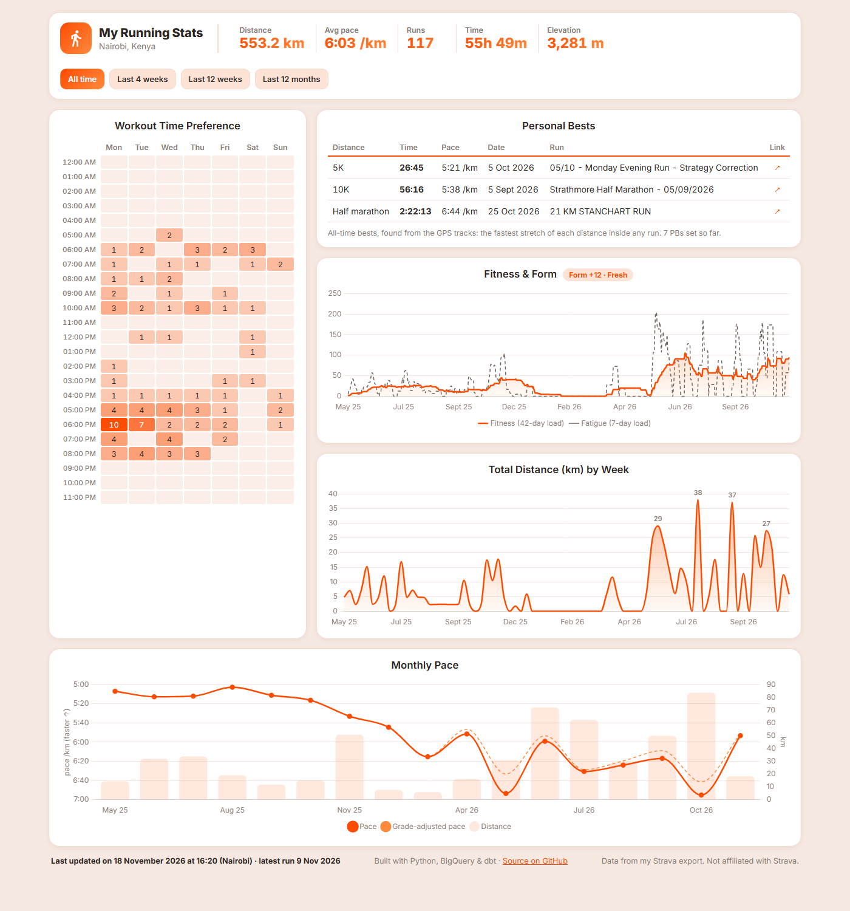

# My Strava Running Stats

A personal analytics engineering project. It takes my Strava data export, models it in BigQuery with dbt, and publishes a public dashboard with metrics Strava normally keeps behind its paid tier.

**🔗 Live dashboard: [jnyambok.github.io/My-Strava-Running-Stats](https://jnyambok.github.io/My-Strava-Running-Stats/)**

[](https://jnyambok.github.io/My-Strava-Running-Stats/)

## Top insights

From 117 runs between May 2025 and November 2026:

- **553 km in 55.8 hours of running**, with 3,281 m of climbing.
- **Fewer runs, twice the distance.** 2026 has fewer runs than 2025 (50 vs 67) but twice the kilometres (369 vs 185). The average run grew from 2.8 km to 7.4 km while training for half marathons.
- **Slower pace is the point.** Monthly pace slowed from about 5:07/km to 6:55/km as monthly distance grew from 14 km to 84 km. Long runs are run easy, which is why pace sits next to distance on the chart.
- **Half marathon PB: 2:22:13** at the Standard Chartered Nairobi Marathon (25 Oct 2026), 6 min 21 s faster than three months earlier.
- **The 10K PB (56:16) was set inside a half marathon.** The best-effort model searches every stretch of every run, not just runs that were exactly 10 km.
- **An evening runner.** 61% of runs start between 4 and 9 PM, 6 PM is the most common start time, and Monday is the busiest day (32 runs, against 6 on Sundays).
- **Biggest week: 38 km** (20 July 2026). There were no runs in January and February 2026, and the fitness chart shows the drop and the rebuild to a peak on 4 July 2026.
- **Form today: +12 (fresh).**

---

## Why

Strava's free tier shows the basics. The more useful training metrics, such as fitness and fatigue trends, best-effort progression and grade-adjusted pace, need a subscription. I wanted to build them myself from the raw data and practise a real analytics engineering workflow along the way.

## How it works

```
Strava export (zip) ──► Python ──► BigQuery ──► dbt ──► data.json ──► Static website (GitHub Pages)
   (every 2 weeks)        └──────── python pipeline.py ─────────┘
```

| Step | Tool | What it does |
|---|---|---|
| Source | Strava bulk export | Every two weeks I request my data archive and drop the zip into `data/raw/` |
| Extract & load | Python | Reads the newest zip and reloads the full history into BigQuery, since every export contains all activities |
| Transform | dbt + BigQuery | Cleans the raw data and builds tested models for the dashboard |
| Export | Python | Writes the final dbt models to a JSON file |
| Present | HTML / CSS / JS + Chart.js | A single-page dashboard on GitHub Pages, showing when the data was last updated |

**Why not the Strava API?** Since June 2026 the Strava API requires a paid subscription, and its terms limit showing data publicly. The bulk export is free and it's my own data, so the pipeline is built around a fortnightly file drop instead.

**Cost: free.** BigQuery runs in the free **sandbox**, with no billing account, so it can't be charged. The sandbox shapes the design:

- **No DML** (`INSERT` / `UPDATE` / `MERGE`), so each run fully reloads the raw tables with batch load jobs and dbt builds plain tables and views rather than incremental models. With about 130 activities, a full reload takes seconds.
- **Tables expire after 60 days**, counted from when the table was *created*: reloading with `WRITE_TRUNCATE` doesn't reset the clock. That's fine, because every pipeline run loads the raw tables first (recreating them if they've expired), the export zip is the source of truth, and the website reads its own `data.json`, so it keeps working even if BigQuery is empty.
- **10 GiB lifetime storage**, so staging models are views (which use no storage) and only the small final tables are stored.

## The data

What the export actually contains:

- **`activities.csv`**: one row per activity, with 104 columns. The export has 117 runs, 11 walks and 2 hikes, from May 2025 to today.
- **`activities/*.gpx`**: one GPS track per activity, with a point roughly every second (position, elevation, time).

What that means for the metrics:

- **No heart-rate data**, because I record on my phone. Effort is measured with **perceived exertion** instead: I rate each run's effort out of 10, and that's filled in for about 70% of activities.
- **Grade-adjusted pace** is included for every run.
- **Cadence** is available for about 60% of activities.
- The CSV has **duplicate column names**, for example two `Distance` columns in different units. Cleaning that up is a job for the dbt staging layer.

Only `activities.csv` and the GPX files are used. The rest of the export (messages, logins, contacts and so on) is never loaded, and raw data is never committed to git.

## Metrics

- **Totals:** distance, runs, moving time, elevation
- **Weekly activity:** distance per week
- **Best efforts:** fastest 5K, 10K and half marathon over time, found from the GPS tracks
- **Fitness & form:** 42-day fitness vs 7-day fatigue, using training load = perceived exertion × minutes
- **Pace trends:** average and grade-adjusted pace over time

## Key Attributes

The engineering ideas this project demonstrates, and why they matter.

### Idempotency
Running the pipeline once or ten times on the same export gives exactly the same data. Pipelines get rerun all the time (failures, retries, backfills, debugging), and a non-idempotent pipeline silently double-counts on every rerun.

Idempotency isn't one line of code. It's a chain, and every link has to hold:

| Link | Where | What it guarantees |
|---|---|---|
| **1. Unambiguous input** | `find_export()` requires exactly one zip | The same command always reads the same file, with no guessing by file timestamp |
| **2. Full history per input** | How Strava exports work | One zip contains everything, so loads never need combining |
| **3. Deterministic reading** | `read_activities()` and `read_tracks()` | The same zip always produces the same rows |
| **4. Fixed schema** | Explicit `SchemaField` list, no autodetect | The table has the same shape on every load |
| **5. Replace, not add** | BigQuery `WRITE_TRUNCATE` | Old data is thrown away, so earlier runs can't leak into new ones |
| **6. All-or-nothing load** | BigQuery load jobs are atomic | A failed load leaves the previous table intact, so it's always safe to rerun after a crash |

**Same zip in, same tables out, however many times it runs.**

- **Evidence.** I ran the load twice in a row: 130 activities and 255,651 track points both times. Only `_loaded_at` changed, which is metadata about *when* it ran, not the data itself.
- **Safety net.** A dbt `unique` test on `activity_id` fails the build if a duplicate ever appears. The pipeline is designed so duplicates can't happen, and the test checks that they didn't.
- **Trade-off.** I chose full refresh over incremental `MERGE` because the data is small and the BigQuery sandbox doesn't support DML. At scale, I'd switch to incremental models with a merge or partition strategy.

### A raw layer that mirrors the source (ELT, not ETL)
Python only **extracts and loads**: it copies `activities.csv` and the GPX track points into BigQuery as close to the source as possible, with every value kept as text. All cleaning, typing and calculations (units, paces, best efforts) happen afterwards in dbt.

- **Why:** if a transformation turns out to be wrong, I fix the dbt model and rebuild. I never have to re-extract, and the original data is always there to check against.
- **Minimal reshaping only:** column names are made BigQuery-safe (`Activity Date` → `activity_date`, duplicate headers become `distance_2`), and nested GPX XML is flattened into one row per GPS point (about 256,000 rows).
- **Nothing is dropped silently:** activities without a GPX file (one `.fit` walk) are skipped and reported, not quietly ignored.

### Configuration lives outside the code
The BigQuery project and dataset names are read from a git-ignored `.env` file, with a committed `.env.example` as the template. They aren't secrets, but keeping them out of the code means anyone can point the pipeline at their own project, and Python and dbt read the same settings from one place.

- **No silent defaults.** If `GCP_PROJECT_ID` is missing, the loader stops with a clear message instead of falling back to gcloud's default project, which could be a different, billed project.
- **One setting, two tools.** dbt's `profiles.yml` reads the same value with `env_var('GCP_PROJECT_ID')`. dbt loads `.env` automatically, and it logs in with `oauth` (my saved Google login), so no key files exist anywhere.
- **Pinned dependencies.** `requirements.txt` pins `dbt-core~=1.12.0`. Unpinned, pip installed a 1.13 *beta*. Pinning means the same install gives the same behaviour months later.

### Layered models (medallion: bronze → silver → gold)
Data moves through three layers, and each one has a single job:

| Medallion | Here | Job |
|---|---|---|
| **Bronze** | `strava_raw` (Python loads it) | The source exactly as it arrived, all text |
| **Silver** | dbt `staging` views | One model per raw table: pick columns, rename, cast types. No joins, no business logic |
| **Gold** | dbt `marts` tables | Business-ready answers for the dashboard: runs only, weekly totals, best efforts |

- **Staging mirrors the source one-to-one.** Every row of the raw table survives (walks and hikes too); filtering to runs happens in the marts. If I later want walk stats, the clean data is already there.
- **Privacy is decided at the doorway.** Private notes and descriptions are never selected in staging, so nothing downstream can leak them to the public site.

### A public dashboard with nothing to leak
The site is plain HTML, CSS and JavaScript in `docs/`, served by GitHub Pages. `export/export_data.py` writes the marts to `docs/data.json`, and the page draws everything from that one file with Chart.js.

- **No credentials in the browser.** The page never talks to BigQuery, so there's no key to steal, and it keeps working even after the sandbox tables expire.
- **Export only what's shown.** `data.json` is public, so it holds no GPS coordinates, no private notes and no everyday run titles (many of mine name my home estate). Only the personal-best race names are included.
- **Same rules as the warehouse.** The time filter's average pace is total time ÷ total distance, and the "Last 4 weeks" range counts back from the last run in the data, not from today, so the page shows the same numbers whenever it's opened.

### Data tests guard every layer
Each test is a query that returns bad rows; zero rows means pass. `dbt build` runs them straight after each model, so a failing model stops everything downstream from building on bad data, and the dashboard never sees it.

| Test | Column | Protects against |
|---|---|---|
| `unique` + `not_null` | `activity_id` | Duplicate or missing activities (the idempotency safety net) |
| `accepted_values` | `activity_type` | A new type (e.g. a ride) slipping into the run metrics unnoticed |
| `relationships` | `track_points.activity_id` | GPS points with no matching activity (a foreign-key check BigQuery doesn't enforce) |
| Singular SQL test | `activity_id` + `point_index` | Duplicate GPS points. `unique` only takes one column, so the two-column grain gets its own query |

### Empty weeks count as zero (date spine)
`fct_weekly_runs` has one row per week from my first run to my last: 79 weeks, of which only 51 have runs. A plain `group by` would return just the 51, so a chart would skip straight over a month off and the average weekly distance would look higher than it really is.

- **Spine, then left join.** `generate_date_array` builds every Monday, and the weekly totals are left-joined onto it, so weeks with no runs survive and become 0.
- **NULL vs 0.** Distance in an empty week is 0. Training load in a week where runs weren't rated stays NULL, because it's *unknown*, not zero.
- **Deterministic range.** The spine runs from the first to the last run in the data, not to `current_date()`, so rebuilding the same export always gives the same rows (idempotency again).
- **Reconciliation test.** A singular test checks that total km in the weekly table equals total km in `fct_runs`. A join that drops or duplicates runs would fail it, even if `unique` and `not_null` passed.

### Fitness & form with window functions
`fct_daily_fitness` has one row per day. Each run's load is effort (1–10) × minutes; fitness is the load over the last 42 days ÷ 42, fatigue the last 7 days ÷ 7, and form is fitness − fatigue.

- **Window functions keep every row.** `sum(...) over (order by day rows between 41 preceding and current row)` adds a rolling total next to each day, where `group by` would collapse the rows.
- **The spine makes rows = days.** `rows between 6 preceding` counts *rows*. Without a row for every rest day it would mean "the last 7 runs", which could stretch over weeks. (`range between` on `unix_date(day)` is the alternative that counts by value.)
- **Divide by 42, not `avg()`.** In the first weeks of data `avg()` would divide by fewer days and overstate fitness. There was no training before the history starts, so those days count as 0.
- **Honest estimates.** 34 of 117 runs have no effort rating. Counting them as 0 load would make fitness crash, so they use my average rating, and `estimated_runs` records how many runs each day were estimated.
- **Trade-off.** Strava and TrainingPeaks use exponentially weighted averages, which need recursion that SQL handles badly. Simple rolling averages show the same trends.

### Best efforts from raw GPS (self-join on a distance grid)
Strava's best efforts are a paid feature, so `fct_best_efforts` finds the fastest 5K, 10K and half inside every run from the 255,651 GPS points.

- **Intermediate layer.** `int_track_point_distances` measures each step with BigQuery GIS (`st_distance` between `st_geogpoint`s) and keeps a running total per activity with `lag()` and `sum() over (partition by activity_id order by point_index)`. `partition by` stops a window from crossing into another run.
- **Reconciled against Strava.** A test checks that every run's GPS distance is within 5% of Strava's own (actual: +0.65% on average, +2.6% at most, because Strava smooths GPS jitter).
- **The trick.** Comparing every point with every other point is slow. Snapping each track to 10 m marks turns "where was I 5 km later?" into an exact-match self-join (`finish.mark = start.mark + 500`), and the whole model runs in seconds. The cost is up to 10 m (about 3 s) of precision.
- **No special cases.** A 3 km run has no mark 500, so the join simply produces no 5K for it.
- **PB history.** `best_time_s = min(best_time_s) over (partition by effort order by run_date)` flags every run that set a new personal best at the time.

### Averages that don't lie
- **Pace is a ratio, so it's never averaged directly.** Monthly pace is total time ÷ total distance. `avg(pace)` would count a 2 km jog the same as a 20 km long run. In July 2026 it would have reported 6:18/km instead of the true 6:31/km.
- **Grade-adjusted pace is weighted by distance**: `sum(gap × km) / sum(km)`.
- **Knowing when *not* to fill gaps.** The weekly table uses a date spine because an empty week really is 0 km. The monthly pace table doesn't, because a month without runs has no pace at all: filling it with 0 would plot an impossibly fast month. Those months are left out and show as a gap.
- **"Last updated" comes from the data.** The totals table carries the loader's `_loaded_at` timestamp, so the date on the website is when the export was actually loaded, not when the page was built.

### Raw tables are declared as dbt sources
dbt models never hard-code `strava_raw.activities`. They read it through `{{ source('strava', 'activities') }}`, declared once in `models/staging/_sources.yml`.

- **One place to change.** The dataset name comes from `.env` in one YAML line. If it's renamed, or someone runs the project against their own dataset, no SQL changes.
- **Lineage.** dbt knows which models depend on which raw tables, so it builds them in the right order and `dbt docs` draws the graph from raw data to dashboard.
- **Raw data can be tested and documented.** Descriptions state each table's grain (one row per activity, one row per GPS point), and tests can run on the raw tables before any model uses them.

## Progress

### Phase 0: Plan
- [x] Define the goal and the tools
- [x] Choose the data source: bulk export, since the API needs a paid subscription
- [x] Draft the README
- [x] Request the first Strava export
- [x] Explore the export to see what data exists
- [x] Set up the BigQuery sandbox

### Phase 1: Extract & load (Python)
- [x] Create project folders and git-ignore raw data
- [x] Read `activities.csv` from the zip
- [x] Parse the GPX tracks
- [x] Load into BigQuery raw tables (full reload each run)

### Phase 2: Transform (dbt)
- [x] Set up a dbt project connected to BigQuery
- [x] Declare the raw tables as dbt sources
- [x] Staging models: pick columns, rename, cast types
- [x] Tests on the staging models
- [x] Mart models for the dashboard
- [x] Tests and docs on the marts (33 data tests, descriptions on every model)

### Phase 3: Metrics
- [x] Totals
- [x] Weekly distance
- [x] Best efforts (5K / 10K / half)
- [x] Fitness & form
- [x] Pace trends

### Phase 4: Website
- [x] Export the marts to `data.json`
- [x] Page layout with the orange gradient design
- [x] Charts
- [x] "Last updated on …" date
- [x] Publish on GitHub Pages
- [x] Show the time the data was posted, not just the date

### Phase 5: Routine
- [x] One command runs the whole pipeline (`python pipeline.py`)
- [x] Write the "Running it locally" guide
- [x] Final README polish with screenshots
- [ ] Optional: `dbt docs` lineage graph screenshot
- [ ] Optional: GitHub Actions running `dbt build` on every pull request

## Project structure

```
My-Strava-Running-Stats/
├── pipeline.py              one command: load → dbt build → export
├── extract/
│   ├── activities.py        read activities.csv from the export zip
│   ├── tracks.py            parse the GPX tracks into GPS points
│   └── load.py              load both into BigQuery (strava_raw)
├── strava_dbt/
│   ├── profiles.yml         BigQuery connection (oauth, no keys)
│   ├── dbt_project.yml      layers: staging = views, marts = tables
│   ├── models/
│   │   ├── staging/         sources + stg_ views (rename, cast)
│   │   ├── intermediate/    int_track_point_distances (GPS maths)
│   │   └── marts/           fct_ tables the dashboard reads
│   └── tests/               singular tests (grain, reconciliation)
├── export/
│   └── export_data.py       marts → docs/data.json
├── docs/                    the website (GitHub Pages)
│   ├── index.html, styles.css, app.js
│   └── data.json
└── data/raw/                the Strava export zip (git-ignored)
```

## Running it locally

### One-time setup

You need Python 3.11+, the [Google Cloud CLI](https://cloud.google.com/sdk/docs/install) and a Google Cloud project with BigQuery (the free sandbox is enough, no billing account).

1. **Clone and install**

   ```bash
   git clone https://github.com/Jnyambok/My-Strava-Running-Stats.git
   cd My-Strava-Running-Stats
   python -m venv .venv
   .venv\Scripts\activate          # macOS/Linux: source .venv/bin/activate
   pip install -r requirements.txt
   ```

2. **Log in to Google Cloud** (saves credentials that Python and dbt both use; no key files)

   ```bash
   gcloud auth application-default login
   ```

3. **Configure**: copy `.env.example` to `.env` and set `GCP_PROJECT_ID` to your project.

4. **Create the raw dataset** `strava_raw` in BigQuery (US multi-region). dbt creates its own `strava` dataset on the first build.

5. **Check dbt can connect**

   ```bash
   cd strava_dbt
   dbt debug
   ```

### Every update (about every two weeks)

1. On strava.com: **Settings → My Account → Download or Delete Your Account → Request your archive.** Strava emails a download link.
2. Put the zip in `data/raw/` and **delete the old one** (the loader refuses to guess between two zips).
3. Run the pipeline from the project root:

   ```bash
   python pipeline.py
   ```

   It loads the zip into BigQuery, runs `dbt build` (every model and every test), then writes `docs/data.json`. If any step fails, the later steps don't run, so the website never gets data that failed a test.
4. Preview the site: `python -m http.server 8000 --directory docs`, then open http://localhost:8000.
5. Publish: commit and push `docs/data.json`. GitHub Pages updates in a minute or two.

### What's automated, and what isn't

- **Automated:** everything after the zip lands in `data/raw/`: loading, all transformations, 33 data tests and the export, in one command.
- **Not automated, on purpose:** downloading the export. Strava only offers it through a logged-in web page, and scripting that login would break Strava's terms. The API that could replace it now needs a paid subscription. So the routine is one manual download, then one command.
- **Why not a scheduler?** A nightly job would just rerun the same zip. The pipeline is idempotent, so that's harmless but pointless. New data only arrives when I download a new export, so that's the right moment to run it.

---

Data from [Strava](https://www.strava.com). This project is not affiliated with Strava.
